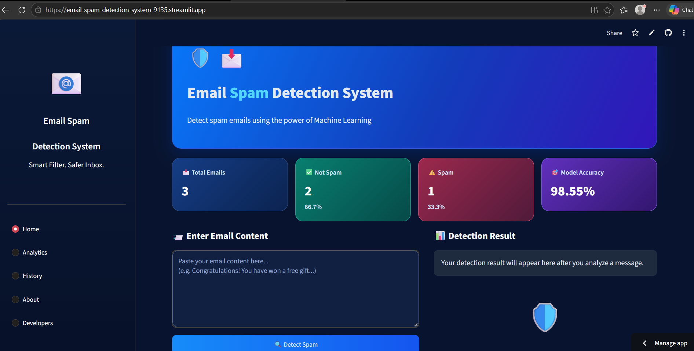
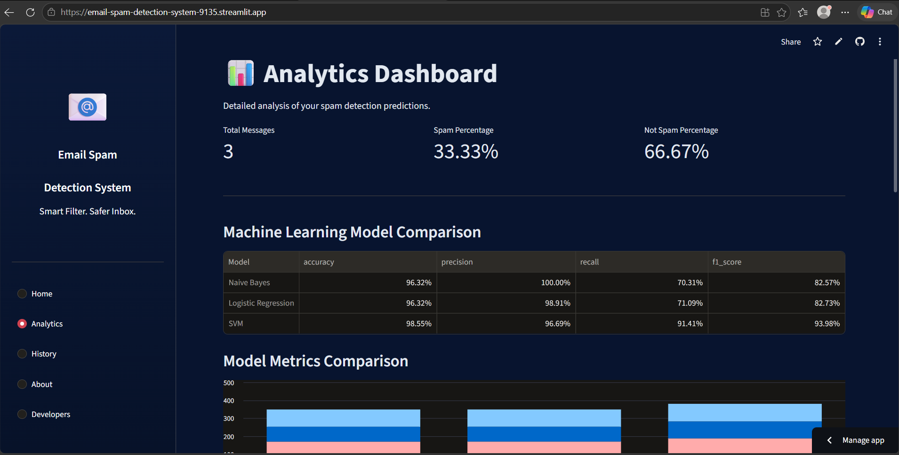
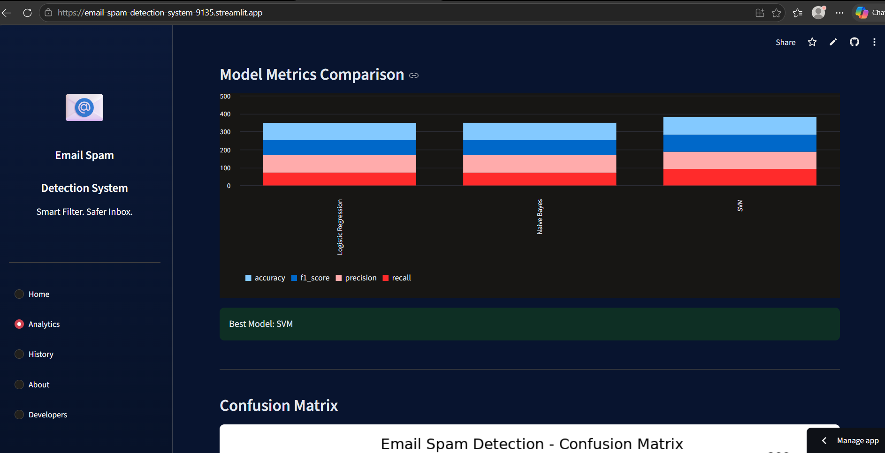
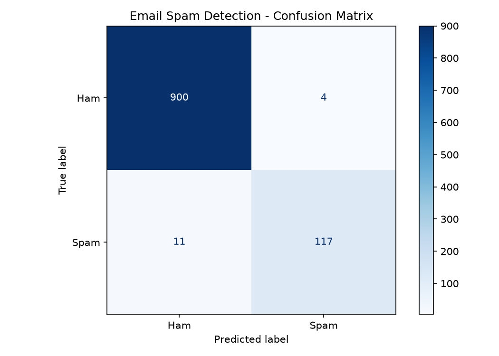

# 📧 Email Spam Detection System

An intelligent Machine Learning-based Spam Detection System that analyzes text messages and predicts whether they are **Spam** or **Not Spam (Ham)**.

🌐 **Live Demo:** https://email-spam-detection-system-9135.streamlit.app/

💻 **GitHub Repository:** https://github.com/pushpastm8252-debug/Email-Spam-Detection-System

---

## 🚀 Project Overview

The Email Spam Detection System is a Machine Learning project developed using Python, Natural Language Processing (NLP), and Streamlit.

It analyzes text messages and classifies them into two categories:

- **Spam:** Unwanted or suspicious messages.
- **Ham:** Legitimate messages.

The application also provides an interactive analytics dashboard, model comparison, confusion matrix visualization, and prediction history.

**Dataset Note:** The current model is trained using the UCI SMS Spam Collection dataset. It is therefore designed for SMS-style text classification rather than being a model validated on a dedicated email dataset.

---

## ✨ Key Features

- Spam and Ham text classification
- Machine Learning-based predictions
- Interactive Streamlit web application
- Analytics dashboard
- Comparison of multiple ML models
- Confusion matrix visualization
- Prediction history using SQLite
- About and Developers sections
- Easy-to-use interface

---

## 🖥️ Application Screenshots

### 1. Home Page

The home page allows users to enter a message and check whether it is Spam or Ham.



### 2. Analytics Dashboard

The analytics dashboard presents information about the dataset and model performance.



### 3. Machine Learning Model Comparison

Comparison of Naive Bayes, Logistic Regression, and SVM models.



### 4. Confusion Matrix

Visualization of the selected model's classification performance.



---

## 🧠 Machine Learning Models

Three Machine Learning algorithms were trained and evaluated:

1. Naive Bayes
2. Logistic Regression
3. Support Vector Machine (SVM)

### Model Performance

| Model | Accuracy | F1-Score |
|---|---:|---:|
| Naive Bayes | 96.32% | 82.57% |
| Logistic Regression | 96.32% | 82.73% |
| SVM | **98.55%** | **93.98%** |

### Best Performing Model: SVM

Support Vector Machine achieved the highest accuracy and F1-score among the evaluated models and was selected as the best-performing model.

---

## 🛠️ Technologies Used

| Technology | Purpose |
|---|---|
| Python | Core programming |
| Pandas | Data manipulation |
| NumPy | Numerical operations |
| Scikit-learn | Machine Learning |
| NLP | Text preprocessing |
| Matplotlib | Data visualization |
| Streamlit | Web application |
| SQLite | Prediction history |
| Joblib | Model saving and loading |
| Git & GitHub | Version control |
| Streamlit Community Cloud | Deployment |

---

## 📂 Project Structure

```text
Email-Spam-Detection-System/
│
├── assets/
│   ├── screenshots/
│   │   ├── home.png
│   │   ├── analytics.png
│   │   ├── model_comparison.png
│   │   └── confusion_matrix.png
│   │
│   └── developers/
│       ├── mohit_kumar.jpg
│       └── pushpa_kumari.jpg
│
├── dataset/
│   ├── SMSSpamCollection
│   ├── raw_spam_data.csv
│   └── cleaned_spam_data.csv
│
├── models/
│   ├── best_spam_model.joblib
│   ├── confusion_matrix.png
│   └── model_metrics.json
│
├── database/
├── notebooks/
├── app.py
├── developers_section.py
├── preprocess.py
├── train_model.py
├── requirements.txt
├── README.md
└── .gitignore
```

---

## ⚙️ Installation and Setup

Follow these steps to run the project locally.

### Step 1: Clone the Repository

```bash
git clone https://github.com/pushpastm8252-debug/Email-Spam-Detection-System.git
```

### Step 2: Open the Project Folder

```bash
cd Email-Spam-Detection-System
```

### Step 3: Create a Virtual Environment

```bash
python -m venv venv
```

### Step 4: Activate the Virtual Environment

**Windows PowerShell:**

```powershell
.\venv\Scripts\Activate.ps1
```

### Step 5: Install Dependencies

```bash
pip install -r requirements.txt
```

### Step 6: Run the Application

```bash
streamlit run app.py
```

The application will open in your web browser.

---

## 📊 How It Works

1. The user enters a text message.
2. The application preprocesses the input text.
3. The trained Machine Learning model analyzes the message.
4. The model predicts whether the message is Spam or Ham.
5. The prediction result is displayed.
6. Prediction history can be stored and viewed through the application.

---

## 🔮 Future Improvements

- Train and validate the model using a dedicated email dataset.
- Improve spam detection performance.
- Integrate email services for email classification.
- Explore advanced NLP and Deep Learning techniques.
- Add multilingual spam detection.
- Improve analytics and user experience.

---

## 👩‍💻 Developers

This project was developed through collaboration between two B.Tech students interested in Artificial Intelligence, Machine Learning, and practical software development.

### Pushpa Kumari

**B.Tech Computer Science – AI & ML**

AI/ML and Python Developer

Interested in Python, Machine Learning, Generative AI, RAG, and real-world software projects.

**Skills:** Python, Java, C, C++, Machine Learning, Generative AI, RAG, Streamlit, SQL, GitHub.

**Contribution:** Project development, Machine Learning implementation, and application development.

**Profile Links:**
- Email: pushpastm8252@gmail.com
- [LinkedIn](https://www.linkedin.com/in/pushpa-kumari-302184380)
- [GitHub](https://github.com/pushpastm8252-debug)


### Mohit Kumar

**B.Tech – Artificial Intelligence & Machine Learning**

AI & ML Developer

Interested in Python development, Embedded Systems, IoT, and practical technology projects.

**Skills:** Python, C, C++, SQL, NumPy, Pandas, Arduino, IoT.

**Contribution:** Technical development and project collaboration.

**Profile Links:**
- Email: mk7469112@gmail.com
- [LinkedIn](https://www.linkedin.com/in/mohit-kumar-07to18)
- [GitHub](https://github.com/Mohitkumar-lan)


---

## 🤝 Team Collaboration

This project was developed through technical collaboration between Pushpa Kumari and Mohit Kumar.

Both developers contributed to the development and improvement of the application.

**GitHub Repository:** https://github.com/pushpastm8252-debug/Email-Spam-Detection-System

---

## 📚 Dataset Acknowledgement

The project uses the **UCI SMS Spam Collection Dataset** for Spam and Ham text classification.

The dataset is used for educational and Machine Learning experimentation.

---

## ⭐ Support

If you find this project useful, please consider giving the repository a star on GitHub!

**Built with Python, Machine Learning, NLP, and Streamlit.**